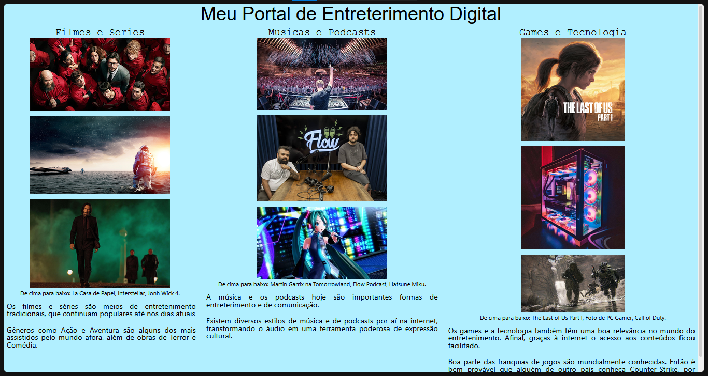

# Portal de Entreterimento  

## Sobre

Esse é um portal web sobre entreterimento digital feito com HTML e CSS. A página contém três seções com formas diferentes de entreterimento, sendo:
- Filmes e Séries
- Músicas e Podcasts
- Games e Tecnologia

Cada uma das seções possui um texto breve sobre o assunto.

## Ferramentas Utilizadas

* HTML
* CSS

## Como testar

Acesse pelo link do GitHub Pages: <a href="https://marcuss25.github.io/portal-entreterimento/" target="_blank">portal-entreterimento</a>
